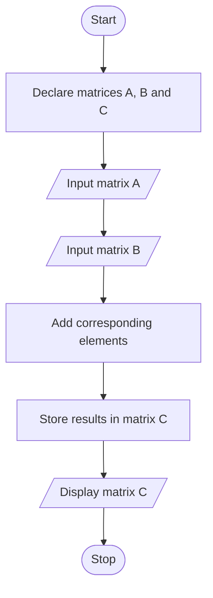

# Addition-Of-Two-Matrices


# Assignment 4: Matrix Addition in C

## 1. Problem Statement

Write a program in C to perform basic matrix operations, such as the addition of two matrices.

## 2. Objectives

- To learn and understand arrays in C.
- To understand two-dimensional arrays and their operations.
- To perform matrix addition using nested `for` loops.
- To learn how to input and display matrix elements.

## 3. Theory

### What is an Array?

An array is a collection of elements of the same data type stored in contiguous memory locations. It allows multiple values to be stored under a single variable name.

**Syntax:**

```c
data_type array_name[size];
```

**Example:**

```c
int numbers[5] = {10, 20, 30, 40, 50};
```

### Types of Arrays

1. **One-dimensional array:** Stores elements in a single sequence.
2. **Two-dimensional array:** Stores elements in rows and columns and is commonly used to represent matrices.
3. **Multidimensional array:** Stores elements using three or more dimensions.

**Example of a two-dimensional array:**

```c
int matrix[2][2] = {
    {1, 2},
    {3, 4}
};
```

### What is a `for` Loop?

A `for` loop is used to execute a block of code repeatedly while a specified condition remains true.

**Syntax:**

```c
for (initialization; condition; update) {
    // Statements
}
```

Nested `for` loops are used in matrix addition to access each row and column.

## 4. Algorithm

1. Start the program.
2. Declare three two-dimensional arrays: `A`, `B`, and `C`.
3. Read the elements of the first matrix.
4. Read the elements of the second matrix.
5. Add corresponding elements of both matrices.
6. Store the results in matrix `C`.
7. Display the resultant matrix.
8. Stop the program.

**Formula:**

`C[i][j] = A[i][j] + B[i][j]`

## 5. C Program

```c
#include <stdio.h>

int main() {
    int A[2][3], B[2][3], C[2][3];
    int i, j;

    printf("Enter elements of the first matrix:\n");
    for (i = 0; i < 2; i++) {
        for (j = 0; j < 3; j++) {
            scanf("%d", &A[i][j]);
        }
    }

    printf("Enter elements of the second matrix:\n");
    for (i = 0; i < 2; i++) {
        for (j = 0; j < 3; j++) {
            scanf("%d", &B[i][j]);
        }
    }

    for (i = 0; i < 2; i++) {
        for (j = 0; j < 3; j++) {
            C[i][j] = A[i][j] + B[i][j];
        }
    }

    printf("Addition of two matrices is:\n");
    for (i = 0; i < 2; i++) {
        for (j = 0; j < 3; j++) {
            printf("%d ", C[i][j]);
        }
        printf("\n");
    }

    return 0;
}
```

## 6. Sample Input

```text
Enter elements of the first matrix:
1 2 3
1 2 3
Enter elements of the second matrix:
1 2 3
1 2 3
```

## 7. Output

```text
Addition of two matrices is:
2 4 6
2 4 6
```

## 8. Flowchart



## 9. FAQs

### Q1. How are arrays initialized and processed?

Arrays can be initialized during declaration or populated using input statements. Loops are commonly used to process their elements.

### Q2. How are elements accessed in a two-dimensional array?

Elements are accessed using row and column indices. For example, `A[1][2]` refers to the element in the second row and third column.

### Q3. What are the advantages and disadvantages of arrays?

**Advantages:**
- Store multiple values under one variable name.
- Provide direct access through indices.
- Simplify repetitive operations.

**Disadvantages:**
- Ordinary arrays have a fixed size.
- All elements must have the same data type.
- Insertion and deletion can require shifting elements.

## 10. Conclusion

Thus, the program to perform matrix addition was implemented successfully in C. This experiment helped develop an understanding of arrays, two-dimensional arrays, nested loops, and matrix operations.
